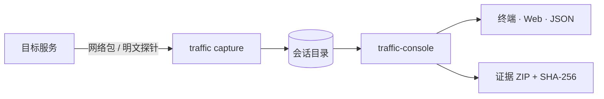

<p align="center">
  
</p>

<p align="center">
  <strong>把网站请求、响应、检测依据与网络证据，放进同一个可回看的会话。</strong>
</p>

<p align="center">
  <a href="https://github.com/Sunmedalia/traffic/actions/workflows/ci.yml"></a>
  <a href="https://github.com/Sunmedalia/traffic/releases"></a>
  
  
</p>

<p align="center">
  <a href="#快速开始">快速开始</a> ·
  <a href="#选择采集后端">选择后端</a> ·
  <a href="#分析会话">分析会话</a> ·
  <a href="docs/guide.md">使用手册</a> ·
  <a href="VALIDATION.md">验证记录</a> ·
  <a href="https://github.com/Sunmedalia/traffic/releases">下载</a>
</p>

## 为什么使用 traffic

`traffic` 面向网站应急响应：在目标机上保存 HTTP/HTTPS 请求与响应，通过中文终端、浏览器或 JSON 命令分析，再导出带 SHA-256 清单的证据 ZIP。

| 采集现场 | 分析请求 | 留存证据 |
| :--- | :--- | :--- |
| 网卡抓包与可选的 TLS 明文探针 | 概览、请求、告警聚合、健康状态 | SQLite 索引、循环 PCAP、明文事件 |
| 按进程、端口及服务选择目标 | 规则命中高亮、筛选、详情查找 | 按请求导出正文、关联包与诊断 |
| 缺口、截断、退出状态显式记录 | 中文 TUI、Web、JSON 共用会话 | 采集与分析分离，可离机回看 |



> **当前发布边界**：HTTP/2 已有有界解析和自动化回归，完整后端实机矩阵仍待验收。持续高负载仍有接收队列溢出样本，低影响门槛、八小时长压和部分后端排空确认尚未完成。已知缺口见 [优化进度](OPTIMIZATION.md)，实测结果见 [验证记录](VALIDATION.md)，本轮修复见 [边界审核](docs/boundary-review-2026-11-17.md)。

## 采集与本地分析分离

> **版本提示**：v0.1.3 起使用采集与本地分析分离流程。旧版 v0.1.2 采集时直接检测并写 `index.sqlite`，使用旧发行包请参考 [v0.1.2 发布说明](docs/releases/v0.1.2.md)。


`traffic capture` / `traffic import` 只保存原始网络包、探针明文事件和元数据，不执行 TCP/HTTP 还原、配对、索引、规则匹配或告警外送。停止采集后，将整个会话目录复制到本地，运行：

```bash
./traffic-console analyze --session ./sessions/first-capture
# 可追加自定义规则；每次 analyze 都重新计算并替换上次结果
./traffic-console analyze --session ./sessions/first-capture --rules ./rules.yaml
./traffic-console --session ./sessions/first-capture
# 或用浏览器查看同一份分析结果
./traffic-console web --session ./sessions/first-capture
```

`traffic-console analyze` 在本地完成 TCP/HTTP 还原、请求响应配对、索引和规则匹配。新会话使用布局 v3，采集阶段没有 `index.sqlite`；未分析时只能查看采集状态，需先执行分析才能浏览请求。旧版带 `index.sqlite` 的会话仍可打开和重新匹配规则。

本地结果写入不可变的 `analysis-*.sqlite`，由 `analysis-current.json` 原子选择当前版本。新会话的本地结果包括还原正文、索引、告警和规则快照；旧会话仅追加告警分析，不改原索引。失败或取消保留上次完整结果；PCAP、TLS 原始事件及采集状态保持只读。请求与响应正文的本地还原、检测上限默认各 1 MiB，可用 `analyze --request-limit 2097152 --response-limit 2097152` 调大后重跑，最大各 16 MiB。提高上限可重新读取原始流量，无法补回实际漏采的字节。

Web 顶部导航的「规则」页（`#/rules`）支持新建、导入、编辑、实时校验、保存、下载和删除 YAML 文件，并预览解析出的规则；「分析」页（`#/analysis`）选择规则和会话执行 / 停止后台分析，并列出最近任务，完成后页面自动更新告警。规则默认存放在程序旁的 `rules/`（源码 `bin/` 构建使用项目根目录），可用 `traffic-console web --rules-dir /path/to/rules` 指定。内置规则只读，自定义文件按需追加，修改文件后需重新分析。[规则目录说明](rules/README.md)

`--request-limit`、`--response-limit`、`--rules`、`--scan-window`、`--scan-paths`、`--alert-webhook` 已移到 `traffic-console analyze`；规则校验改用 `traffic-console rules check FILE`。`--retention` 已删除；`--no-detect` 仅保留为采集器兼容参数。**升级后请先执行 `traffic-console analyze`，再浏览新采集的会话。**

## 下载与安装

从 [Releases](https://github.com/Sunmedalia/traffic/releases) 下载对应系统、架构与组件的包，用同版本 `SHA256SUMS` 核对。**采集器和分析器分开下载**：只采集时下载 `traffic`，查看会话时下载 `traffic-console`（原 `traffic-tui`）。

| 平台 | 采集器 | 分析器 |
| :--- | :--- | :--- |
| Ubuntu x64 / ARM64 | `traffic-v0.1.3-ubuntu-{amd64,arm64}.tar.gz` | `traffic-console-v0.1.3-ubuntu-{amd64,arm64}.tar.gz` |
| CentOS 7+ x64 / ARM64 | `traffic-v0.1.3-centos7-{amd64,arm64}.tar.gz` | `traffic-console-v0.1.3-centos7-{amd64,arm64}.tar.gz` |
| Windows x64 | `traffic-v0.1.3-windows-amd64.zip` | `traffic-console-v0.1.3-windows-amd64.zip` |

Linux 主程序静态链接 libpcap，无需安装运行库；采集包内置配套 eCapture、Java Agent 和 glibc 2.17 基线的 OpenSSL 预加载库。CentOS 提供可直接运行的包。Ubuntu/CentOS 包使用同一兼容构建基线，并分别在干净的发行版容器中检查。

Windows 采集包内置 WinDivert 签名驱动、Python、Frida 和探针脚本。**无需安装 Npcap、系统 Python 或下载独立依赖包**。完整解压后直接运行 `doctor`；管理员终端执行 `capture` 时按需加载随包驱动。不要只复制 exe。详见 [Windows 随包依赖](docs/windows-dependencies.md)。

```bash
# Ubuntu x64；CentOS 改用 centos7-amd64 文件名
 tar -xzf traffic-v0.1.3-ubuntu-amd64.tar.gz
 cd traffic-v0.1.3-ubuntu-amd64
 ./traffic --cn-help
 ./traffic doctor --cn-help
 sudo ./traffic doctor
 sudo ./traffic capture --ports 80,443 --duration 60s
```

依赖路径自动按程序所在目录解析，帮助页面包含每个命令的专属参数和示例。`traffic doctor` 默认显示中文分区自检报告；脚本读取使用 `traffic doctor --json`，保持原有 JSON 字段。HTTPS 能力仍取决于目标与内核：CentOS 7 原生内核不具备 CO-RE BTF，需要服务启动时加载随包预加载库；程序不会重启业务服务。Java attach 依赖目标 JVM 自身的 attach 能力。

首次启动任一程序会自动在程序旁创建 `sessions/` 和 `exports/`，从其他目录启动也会使用同一默认数据目录。源码构建位于 `bin/` 时，目录创建在项目根目录；显式 `--data-dir` / `--output` 仍按指定路径处理。请将程序解压到可写目录。

从源码构建需要 Go 1.26.7+、CGO 和 C 编译器：

```bash
sudo apt-get update
sudo apt-get install -y build-essential libpcap-dev git
git clone --branch v0.1.3 https://github.com/Sunmedalia/traffic.git
cd traffic
./scripts/build-linux.sh
```

macOS 可从源码构建分析器：`go build -o bin/traffic-console ./cmd/traffic-console`。其他构建方式见 [分平台构建](docs/guide.md#构建分平台)。

## 快速开始

### 1 · 先采一段 HTTP

```bash
# 指定业务的实际 HTTP 端口；--no-tls 不启动明文探针
sudo ./traffic capture --no-tls --ports 80,8080 \
  --duration 60s --output ./sessions/first-capture
```

省略接口时，Linux 使用 `any`，包含回环。省略 `--output` 时自动存入程序旁的 `sessions/`。程序在 stderr 打印会话路径；`Ctrl+C` 正常停止并保存摘要。

### 2 · 打开会话

```bash
# 停采后在本地执行规则分析
./traffic-console analyze --session ./sessions/first-capture

# 中文终端界面；无参数时进入会话选择页
./traffic-console --session ./sessions/first-capture

# 浏览器界面；打开启动时打印的完整令牌地址
./traffic-console web --session ./sessions/first-capture
```

### 3 · 按需启用 HTTPS 明文采集

现代 Linux 的 OpenSSL 服务默认使用采集包中的配套 eCapture，无需额外下载或指定路径：

```bash
sudo ./traffic doctor --service nginx --ports 443
sudo ./traffic capture --service nginx --ports 443 --duration 60s --output ./sessions/https-capture
```

自行开发探针时仍可使用仓库中的 `scripts/build-ecapture.sh`，或通过 `--ecapture` 覆盖默认路径。

eCapture 走进程明文读取路径，无需安装 CA 或解密 PCAP。附加存在启动窗口；用已知请求的唯一编号逐条核对请求、响应和正文，不能只根据 `attached` 或零丢弃判定采全。

## 选择采集后端

| 环境 | 方式 | 是否需要重启目标 | 主要边界 |
| :--- | :--- | :---: | :--- |
| 普通 HTTP | `--no-tls` | 否 | 明文协议与选定端口 |
| Linux nginx / Apache | eCapture / eBPF | 否 | 内核能力、动态 libssl、附加窗口 |
| 通用 OpenSSL | `--service openssl --pid N` | 否 | 指定进程；自定义 BIO 需逐项验证 |
| 旧内核 / 无 BTF | OpenSSL 预加载库 | 是 | 显式启动加载；队列丢弃和退出尾部仍有边界 |
| Tomcat NIO | `--java-attach` | 否 | JDK 17/21；目标需允许动态附加 |
| Windows IIS | WinDivert + IIS 探针 | 否 | 随包自动配置 Frida；已有异步接收可能漏采 |
| Windows nginx / Apache | WinDivert + OpenSSL 探针 | 否 | 静态 OpenSSL 按二进制哈希匹配 profile |
| 已有明文 HTTP PCAP | `traffic import` | 不涉及 | 加密 PCAP 本身不能还原 HTTPS 明文 |

Linux ARM64/x64、CentOS 7、Windows 的实机样本覆盖范围各不相同；完整矩阵见 [验证范围](docs/guide.md#验证范围)。[后端参数与操作步骤 →](docs/guide.md#常见场景复制即用)

## 分析会话

### 终端：概览 → 请求 → 告警 → 健康

| 页面 | 主要操作 |
| :--- | :--- |
| **概览** | 查看级别分布、命中规则、来源与最近高危，按 `Enter` 下钻 |
| **请求** | 查看请求与响应、HTTP/2 stream ID、截断及完整性原因 |
| **告警** | 按规则、来源或逐条查看，命中片段高亮 |
| **健康** | 核对缺口、排空、退出确认、探针和资源限制 |

常用键：`1`–`4` 切页，`/` 筛选，`Enter` 详情，`v` 切换告警聚合，`g` 跟随最新，`e` 导出，`?` 帮助。光标离开最新记录后列表定格，避免新数据打断浏览。[完整快捷键 →](docs/guide.md#终端界面)

### Web：时间线、筛选与详情

Web 支持请求与告警时间线、按来源/方法/状态/级别组合筛选、命中高亮、JSON 正文格式化、复制 cURL 和证据导出。地址栏保留当前视图，可分享给持有访问令牌的同事。

默认只监听回环；远程查看可使用 SSH 转发：

```bash
ssh -L 8080:127.0.0.1:8080 user@capture-host
```

### JSON：查询与证据导出

```bash
./traffic-console status --session ./sessions/https-capture
./traffic-console events --session ./sessions/https-capture --severity medium
./traffic-console show REQUEST_ID --session ./sessions/https-capture
./traffic-console export REQUEST_ID --session ./sessions/https-capture --out ./evidence.zip
```

`--severity medium` 表示中危及以上。**导出前需要停止采集**，同名 ZIP 不覆盖。

## 如何判断采集完整性

```text
sessions/<host>/<date>/<session>/
├── manifest.json    构建、主机与采集条件
├── status.json      心跳、计数、资源及退出状态
├── gaps.jsonl       已知缺口及计量单位
├── analysis-current.json  本地分析成功后创建的结果指针
├── analysis-*.sqlite      本地还原、索引、告警与规则快照
├── packets/         顺序分段 PCAP，HTTPS 仍是密文
├── tls/stream.jsonl 探针明文原始事件（按需创建）
└── logs/            诊断日志
```

- **已知丢失**：查看 `gap_counts`、`gaps.jsonl`、`tls_dropped`、`queue_dropped`、`dropped`；各指标单位不同，不可当成漏采请求数相加。
- **未知覆盖**：`tls_coverage=unverified` 与 `tls_missing_estimate=null` 表示启动窗口和探针盲区未量化。零观测丢弃不能证明完整。
- **退出确认**：`drain_state` 与 `probe_exits` 区分数据排空、hook 恢复及运行时状态；停止辅助进程不代表目标内探针完全卸载。

采集端不按 HTTP 正文截断，也不清理索引；PCAP 分段顺序保留，达到会话磁盘预算（默认 2 GiB）时停止。磁盘检查有间隔，预算不是硬字节上限；剩余空间低于 512 MiB 也会停止。探针仍有单事件、队列和附加覆盖限制。采集器及子进程默认限制 256 MiB、单核 50%，不包含目标进程内探针开销。完整参数见 [资源与证据限制](docs/guide.md#资源与证据限制)。

## 文档与开发

| 入口 | 内容 |
| :--- | :--- |
| [使用手册](docs/guide.md) | 后端、规则、Windows、参数、停止与回滚、故障排查 |
| [验证记录](VALIDATION.md) | 实机环境、构建哈希、成功与失败样本 |
| [优化进度](OPTIMIZATION.md) | 已实现机制、性能门槛与待完成项目 |
| [v0.1.4 发布说明](docs/releases/v0.1.4.md) | 下载包、升级变化和已知限制 |
| [第三方组件](THIRD_PARTY_NOTICES.md) | 依赖、探针与许可证说明 |

```bash
go test -race ./...
go vet ./...
```

CI 覆盖 Linux ARM64/x64、Windows 原生测试与构建、Java 17/21，以及固定版本 eCapture 补丁回归。CI 通过不替代实际服务的完整性和性能验收。发布包附带依赖许可证；WinDivert、Frida 和 eCapture 的许可分别适用。
