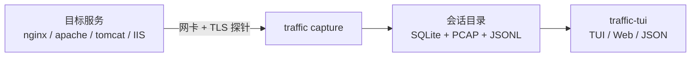

# traffic

面向网站应急响应的流量采集与分析工具。在 Linux / Windows 目标机上采集 HTTP/HTTPS 请求、响应、检测依据和网络证据，用中文 TUI、浏览器或 JSON 命令回看，并导出可校验的证据包。

- **不装 CA、不改业务代码**：Linux 用 eCapture/eBPF 在 OpenSSL 读写处取明文，Windows 用 Npcap 加动态探针。
- **采集与分析分离**：采集器只写会话目录，分析器可在另一台机器打开。
- **完整性显式**：状态文件记录网卡、队列、TLS 丢弃和未知缺口，不把“0 丢弃”说成“采全”。



## 先跑起来（Linux）

```bash
# 1. 构建：需要 Go 1.26.7+、CGO、C 编译器、libpcap
sudo apt-get update && sudo apt-get install -y build-essential libpcap-dev git
git clone https://github.com/Sunmedalia/traffic.git && cd traffic
./scripts/build-linux.sh

# 2. 自检：接口、权限、BTF、eCapture、可发现的 TLS 库
#    此时尚未构建 eCapture，ecapture_installed=false 属正常
./bin/traffic doctor

# 3. 先验证链路：只采 HTTP，不需要 eCapture
sudo ./bin/traffic capture --ports 80,443 --no-tls

# 4. 另开终端分析；无参数会列出会话
./bin/traffic-tui
```

HTTP 链路确认后，再构建 eCapture 采集 HTTPS 明文：

```bash
sudo apt-get install -y clang llvm bpftool libelf-dev libssl-dev \
  flex bison make file pkg-config
./scripts/build-ecapture.sh /tmp/traffic-ecapture-build
sudo ./bin/traffic capture --ports 80,443
```

采集器启动时在 stderr 打印会话绝对路径，停止时写入摘要。先确认这三件事再继续：

1. `status.json` 的 `tls` 为 `attached`（eBPF）或 `active-preload`（预加载），不是 `unavailable`。
2. 从客户端发一条已知请求，`traffic-tui requests` 能看到对应记录。
3. 记录数与你发出的请求数接近；`tls_coverage` 仍是 `unverified` 表示启动窗口和探针盲区无法自动量化，不是错误。

> 只做 HTTP 时始终加 `--no-tls`。HTTPS 明文的依赖、探针版本和边界见 [Linux HTTPS 依赖](#linux-https-依赖与-ecapture)。

## 我该用哪个后端

| 你的场景 | 推荐方式 | 要重启服务吗 | 说明 |
| --- | --- | --- | --- |
| 只看 HTTP | `--no-tls` | 否 | 只需 libpcap |
| Linux nginx / apache | 默认 eBPF（eCapture） | 否 | 自动发现 worker，推荐首选 |
| HAProxy / 其他通用 OpenSSL 程序 | eBPF + `--service openssl --pid N` | 否 | 需要显式指定 PID |
| 内核太旧、无 BTF，或要求逐字节完整 | `LD_PRELOAD` / `ld.so.preload` | 是 | 启动时加载库；系统级预加载支持白名单 |
| Tomcat / JVM HTTPS | `--java-attach` | 否 | 动态附加 Java Agent |
| Windows IIS / nginx / apache | Npcap + 显式启用探针 | 否 | IIS 用 Frida，nginx/apache 用 OpenSSL 探针 |
| 已有 PCAP | `traffic import` | 不涉及 | 离线还原为会话 |
| 在分析机上看别人采的会话 | `traffic-tui` | 不涉及 | 支持 Linux / macOS / Windows |

## 常见场景（复制即用）

### Linux nginx / apache HTTPS

```bash
# 自动发现 nginx worker、apache2/httpd 及其 libssl
sudo ./bin/traffic capture --interfaces eth0 --ports 80,443 \
  --ecapture "$PWD/bin/ecapture" --output ./sessions/incident-001
```

`--interfaces` 省略时使用 `any`（含回环）。`--libssl` 省略时从目标进程的映射自动发现；指定错误路径会让探针挂到错误的库上。多站点共用 worker 和端口时，采集会包含这些站点。

### 指定进程或通用 OpenSSL 服务

```bash
# 通用 OpenSSL 程序必须给 PID，例如 HAProxy
sudo ./bin/traffic capture --service openssl --pid 1234 --ports 9443

# 只采一个进程，其余服务不附加
sudo ./bin/traffic capture --service nginx --pid 1234 --ports 443
```

### 旧内核或需要完整明文：LD_PRELOAD

```bash
# 1. 构建采集库（在目标系统构建，匹配 glibc 与 libpcap）
bash scripts/build-openssl-preload.sh

# 2. 启动采集器，等待 tls=listening-preload
sudo ./bin/traffic capture --interfaces any --ports 443 \
  --openssl-preload-socket /run/traffic/plaintext.sock \
  --output ./sessions/old-kernel

# 3a. 单服务：用环境变量加载库
sudo env LD_PRELOAD="$PWD/bin/libtraffic-openssl.so" \
  TRAFFIC_OPENSSL_SOCKET=/run/traffic/plaintext.sock /path/to/service

# 3b. 系统级：安装库、写配置、启动采集器后重启服务
sudo install -m 755 bin/libtraffic-openssl.so /opt/traffic/bin/
cat > /etc/traffic/openssl-preload.conf <<'EOF'
socket=/run/traffic/plaintext.sock
targets=nginx
EOF
sudo ./bin/traffic capture --interfaces any --ports 443 \
  --openssl-preload-socket /run/traffic/plaintext.sock \
  --openssl-preload-allow-uid 33 --output ./sessions/incident-preload
echo /opt/traffic/bin/libtraffic-openssl.so > /etc/ld.so.preload
systemctl restart nginx
```

非 root worker 需要 `--openssl-preload-allow-uid`：socket 会变成 `0660` 并归属该 UID 的主组。`targets` 之外的进程保持惰性，不会影响 sshd、curl 等。完整说明、回滚和边界见 [系统级 ld.so.preload](#系统级-ldsopreload-与不同-uid-的服务)。

### Tomcat / JVM HTTPS

```bash
./scripts/build-java-agent.sh

sudo ./bin/traffic capture --service tomcat --pid 1234 \
  --ports 8080,8443 --java-attach \
  --java-agent "$PWD/bin/traffic-java-agent.jar"
```

目标 JVM 需要允许动态附加。附加助手默认使用目标 Java；JDK 不匹配时用 `--java-helper` 指定带 `jdk.attach` 的 JDK。

### 只看 HTTP 或导入 PCAP

```bash
# 60 秒普通抓包，不启动 TLS 探针
sudo ./bin/traffic capture --no-tls --duration 60s --output ./sessions/http-001

# 把已有明文 HTTP PCAP 还原为会话
./bin/traffic import capture.pcap --ports 80,8080 --output ./sessions/offline-001
```

### 采集多个服务、多个端口

```bash
sudo ./bin/traffic capture --service auto --ports 80,443,8081,8444,8083,8446 \
  --java-attach --java-pid 1234 --java-agent "$PWD/bin/traffic-java-agent.jar"
```

### 加规则、限制时长、外送告警

```bash
sudo ./bin/traffic capture --ports 80,443 --duration 10m \
  --rules ./rules.yaml \
  --trusted-proxies 10.0.0.0/8,192.0.2.10 \
  --alert-webhook https://siem.example/traffic \
  --output ./sessions/incident-002
```

`TRAFFIC_WEBHOOK_TOKEN` 可带 Bearer 令牌。规则格式见[检测规则](#检测规则)。

### Windows

```powershell
powershell -ExecutionPolicy Bypass -File scripts/windows/build.ps1
.\bin\windows\traffic.exe doctor
.\bin\windows\traffic.exe capture --ports 80,443 --duration 60s --name windows-http
.\bin\windows\traffic-tui.exe
```

IIS、Windows nginx/apache 和通用 OpenSSL 的探针参数见 [Windows 采集](#windows-采集)。

## 分析会话

### 终端界面

```bash
./bin/traffic-tui                                  # 选择会话
./bin/traffic-tui --session ./sessions/incident-001
./bin/traffic-tui --session ./sessions/incident-001 --refresh 2s --severity high
```

选择页用 `↑`/`↓` 或 `j`/`k`，`Enter` 打开，`r` 重扫，`o` 输入其他目录，`q` 退出。分析页常用键：

| 按键 | 操作 |
| --- | --- |
| `1` / `2` / `3` | 概览 / 请求 / 告警 |
| `Enter` | 打开详情 |
| `Tab` / `Shift+Tab` | 请求、响应、解码正文、检测依据 |
| `/` | 筛选面板；`Enter` 应用，`Ctrl+R` 清空 |
| `空格` / `r` | 暂停或恢复自动刷新 / 手动刷新 |
| `s` | 返回会话选择 |
| `?` | 快捷键帮助 |
| `q` / `Ctrl+C` | 退出 |

### 浏览器界面

```bash
./bin/traffic-tui web --session ./sessions/incident-001
./bin/traffic-tui web --data-dir /var/lib/traffic/sessions --listen 127.0.0.1:9000
```

启动后 stderr 会打印带访问令牌的地址，直接打开即可。默认只监听回环，远程分析建议用 `ssh -L 8080:127.0.0.1:8080 user@host` 转发；`--allow-remote` 会让令牌和正文以明文过网，只用于隔离网络。

### 命令行查询

```bash
./bin/traffic-tui status   --session SESSION
./bin/traffic-tui requests --session SESSION --limit 100
./bin/traffic-tui requests --session SESSION --client 192.0.2.10 --rule SQLI-001
./bin/traffic-tui events   --session SESSION --severity high
./bin/traffic-tui show EVENT_ID --session SESSION
./bin/traffic-tui export EVENT_ID --session SESSION --out ./evidence.zip
```

筛选参数：`--since`（RFC3339）、`--client`、`--rule`、`--severity`、`--service`、`--limit`。TUI/Web 另有 Host/URL 关键词。`show` 含可读正文和 base64 字节；原始网络字节在 PCAP 里。采集中不能导出，先停止采集。分析程序以只读方式打开索引，运行用户需要会话目录和文件的读取权限，普通查询不需要 root。

页面分为会话选择、概览、请求和告警四部分，地址栏记录当前会话、标签、筛选条件和打开的记录，刷新、后退和复制地址都会回到同一视图。

- **会话选择**按日期分组，显示状态、主机、请求数和告警数，可按名称、主机或目录查找。
- **概览**显示累计计数、数据缺口提示、请求与告警时间线、命中规则、来源地址、告警级别和响应状态分布、最近告警以及采集状态。点击规则、来源或分布项会跳到对应的筛选结果，在时间线上拖选会把列表限定到这段时间。
- **请求 / 告警列表**每页 100 条，支持 Host/URL 关键词、级别、响应状态、请求方法、来源地址、规则、服务和起止时间组合筛选，输入后即时生效。列表上方的时间线随筛选条件变化，同样可以拖选缩小范围。翻到历史页时保持当前位置，并提示新到达的请求数。
- **详情**显示解码后的 URL、查询参数和表单参数，在请求内容里标出规则命中的片段，JSON 正文可格式化显示。gzip 请求和响应正文在“解码正文”中查看。来源、Host、服务和规则可以直接点击作为筛选条件。“复制 cURL”生成可复现请求的命令，“导出证据”下载与 `traffic-tui export` 相同的 ZIP，采集进行中时导出会被拒绝。

采集中的会话按 `--refresh` 间隔自动刷新，默认每秒一次，最小 500 毫秒。已结束的会话降为每 5 秒检查一次，时间线和统计的刷新间隔不低于 5 秒。索引较大时，响应状态分布超过 1.5 秒会被跳过并在页面上说明。右上角可以切换本地时间与 UTC、深色与浅色配色，详情栏宽度可拖动调整。

| 按键 | 操作 |
| --- | --- |
| `1` / `2` / `3` | 切换概览、请求、告警 |
| `j` / `k` 或 `↓` / `↑` | 下一条、上一条请求 |
| `g` / `G` | 本页第一条、最后一条 |
| `n` / `p` | 下一页、上一页 |
| `[` / `]` | 切换详情标签 |
| `/` | 聚焦搜索框 |
| 空格 / `r` | 暂停或恢复自动刷新 / 立即刷新 |
| `Esc` | 关闭详情或离开输入框 |
| `?` | 打开快捷键帮助 |

## 停止、回滚与清理

| 场景 | 操作 |
| --- | --- |
| 正常结束采集 | `Ctrl+C`，等待摘要写出 |
| 定时结束 | 启动时加 `--duration 10m` |
| 预加载回滚 | `rm -f /etc/ld.so.preload && systemctl restart nginx` |
| 确认库已卸载 | `grep libtraffic /proc/PID/maps` 应无输出 |
| 删除测试产物 | 直接删除会话目录；证据 ZIP 与会话目录分开保存 |
| Web 令牌失效 | 重启 `traffic-tui web`，或用 `TRAFFIC_WEB_TOKEN` 固定 |

程序不会注册系统服务，也不会自动修改业务配置。预加载是唯一需要改动系统配置的路径，且必须显式写入并重启服务。

### 从旧版本升级

- `traffic tui` 改为独立程序 `traffic-tui`。
- `traffic status/requests/events/show/export` 改为 `traffic-tui ...`。
- 原来的 `traffic analyze` 改名为 `traffic import`，用于离线 PCAP。
- 会话格式保持兼容：分析器可读旧版平铺目录和新版分层目录，证据导出同样支持。

## 参数速查

### 采集器 `traffic capture`

| 参数 | 默认 | 用途 |
| --- | --- | --- |
| `--interfaces` | Linux `any` | 网卡列表，逗号分隔 |
| `--ports` | `80,443` | 抓包与 TLS 事件的本地端口 |
| `--service` | `auto` | `auto` / `nginx` / `apache` / `tomcat` / `openssl` / `iis` |
| `--pid` | 0 | 限定目标进程 |
| `--ecapture` | `/opt/traffic/bin/ecapture` | eCapture 路径 |
| `--libssl` | 自动发现 | 指定 TLS 库，排错时很有用 |
| `--no-tls` | 关 | 只做 HTTP，不启动 TLS 探针 |
| `--openssl-preload-socket` | 空 | 启用预加载后端 |
| `--openssl-preload-allow-uid` | 空 | 允许非 root 服务账号写入 |
| `--rules` | 内置 | 追加 YAML 规则 |
| `--trusted-proxies` | 空 | 可信代理 IP/CIDR |
| `--alert-webhook` | 空 | 告警外送地址 |
| `--output` | 自动 | 精确会话目录 |
| `--data-dir` | `./sessions` | 自动命名会话的根目录 |
| `--name` | `capture` | 会话名 |
| `--duration` | 0 | 到时自动停止 |
| `--request-limit` / `--response-limit` | 256 KiB / 64 KiB | 正文保存上限，最大 1 MiB |
| `--disk-limit-mib` | 2048 | 会话磁盘预算 |
| `--retention` | 24h | 索引保留期 |
| `--no-detect` | 关 | 关闭攻击检测 |

`traffic capture --help`、`traffic doctor`、`traffic rules check FILE` 可随时查看。分析器参数用 `traffic-tui --help`。

## 会话目录与完整性

```text
sessions/web-01/2026-11-11/15-04-05-nginx/
├── manifest.json     # 主机、名称、过滤条件、布局版本
├── status.json       # 心跳、计数、丢弃、错误、资源限制
├── index.sqlite      # 请求、响应、告警
├── capture.lock
├── packets/          # 循环 PCAP（原始密文）
├── tls/              # TLS 明文事件 JSONL
└── logs/             # 探针诊断
```

复制会话要复制整个目录（含 `index.sqlite-wal`/`-shm`）。判断完整性看 `status.json`：

- `tls`：`attached` / `active-preload` / `partial` / `unavailable` / `disabled`。
- `tls_dropped`、`queue_dropped`、`dropped`：已观测丢弃，是下限。
- `tls_wire_records` 与 `tls_requests`：外层记录与已保存明文请求，单位不同，不能相减得到漏采数。
- `tls_coverage=unverified`、`tls_missing_estimate=null`：启动窗口和探针盲区未知，需要外部请求计数核对。

## 故障排查

| 症状 | 常见原因 | 处理 |
| --- | --- | --- |
| `doctor` 报 `ecapture_installed: false` | 未构建或路径不对 | 跑 `scripts/build-ecapture.sh`，或用 `--ecapture` 指定 |
| 抓不到任何请求 | 网卡或端口不对 | `ip -br addr` 选接口；确认 `--ports` 含实际监听端口 |
| 只有密文、`tls=unavailable` | 未发现服务、库路径错、后端不支持 | 看 `doctor` 的 targets；指定 `--service` / `--pid` / `--libssl` |
| nginx 采集到了但部分请求缺失 | 附加前已进入的调用、HTTP/2、突发缺口 | 用预加载路径或降低速率；完整性按 `unverified` 处理 |
| 预加载无事件 | 服务未重启、targets 不匹配、socket 权限 | 重启 master；检查 `/etc/traffic/openssl-preload.conf`、`ls -l /run/...`、`--openssl-preload-allow-uid` |
| 预加载报 `bind: no such file or directory` | 父目录不存在（旧版本） | 升级到当前版本，或先 `mkdir -p /run/traffic` |
| `permission denied` 打开 BPF | 非 root 或缺少权限 | 用 `sudo`；容器内需要相应 capability |
| TUI 找不到会话 | 工作目录或路径不对 | `--session` 指向会话目录；`o` 输入其他根目录 |
| 导出失败 | 采集仍在运行，或目标 ZIP 已存在 | 先停止采集，换一个新的输出路径 |
| 时间对不上 | 采集机时钟/时区 | 会话存 UTC，TUI 按本地时区显示；先校时再采 |
| Web 打不开 | 监听地址或令牌 | 用启动时打印的完整地址；远程用 SSH 转发 |

## 检测规则

内置规则覆盖疑似 SQL 注入、命令注入、路径穿越、敏感文件探测、扫描、XSS、SSRF、XXE、SSTI、JNDI、反序列化、Webshell 上传，以及响应中的 passwd / 命令输出特征。原始内容和最多两轮 URL 解码视图参与匹配，gzip 正文有界解压。告警是疑似信号，结论要结合响应和现场证据。

```yaml
- id: CUSTOM-001
  version: 1
  severity: medium
  field: url
  pattern: '(?i)/suspicious-endpoint'
```

```bash
./bin/traffic rules check rules.yaml
sudo ./bin/traffic capture --rules rules.yaml --ports 80,443
```

`field` 支持 `url`、`request`、`response`、`request.headers`、`response.headers`、`request.body`、`response.body`，单个头部用 `request.header.User-Agent` 这类写法。`severity` 为 `low` / `medium` / `high`。扫描检测默认 60 秒内至少 20 个不同路径且一半以上为 404，用 `--scan-window`、`--scan-paths` 调整。

### 可信代理与来源地址

```bash
--trusted-proxies 10.0.0.0/8,192.0.2.10,2001:db8::/32
```

直连对端可信时，从右向左解析 `X-Forwarded-For` 的第一个非可信地址；没有该头时用单值 `X-Real-IP`。索引和告警用解析后的 `client`，`peer_client` 保留直连端点，`client_source` 记录依据。代理头不带端口，解析后端口记为 `0`。

### 告警外送

`--alert-webhook` 异步 POST 告警 JSON，`TRAFFIC_WEBHOOK_TOKEN` 发送 Bearer 令牌，接收端可用 `Idempotency-Key` 去重。单次超时 3 秒，429/5xx 最多重试三次；队列 128 条、4 MiB，退出最多等 5 秒。投递计数在 `status.json`、TUI 和 Web 中显示，失败或溢出的告警仍可从会话索引读取。

## 资源与证据限制

| 项目 | 默认 |
| --- | --- |
| 请求 / 响应正文 | 256 KiB / 64 KiB，超出标记截断 |
| HTTP 头部 | 32 KiB |
| PCAP | 每接口 64 MiB 分段、16 段循环 |
| 会话磁盘预算 | 2 GiB，达到后停止采集 |
| 低磁盘保护 | 可用空间不足 512 MiB 时停止 |
| 索引保留期 | 24 小时 |
| 进程资源 | Linux cgroup v2 / Windows Job Object，256 MiB、单核 50% |

证据 ZIP 含请求、响应、关联 PCAP 和 SHA-256 清单；PCAP 按客户端端点及请求前后各 60 秒筛选，可能包含同连接上的其他请求。HTTPS 明文来自进程探针，PCAP 仍是原始密文。明文事件、Cookie 和认证信息可能出现在会话里，分享前先检查。

## Linux HTTPS 依赖与 eCapture

eCapture 以独立子进程运行，仓库固定上游提交 `143e771cf2b4919aedc27fd7b4b24ff87b8725b9` 并应用补丁。当前构建脚本按主机架构生成 ARM64 或 x86_64 / OpenSSL 3.0、3.5 / CO-RE 探针，包含自定义 BIO 的 socket 关联和 `SSL_read_ex`、`SSL_write_ex` 支持。

```bash
sudo apt-get install -y clang llvm bpftool libelf-dev libssl-dev \
  flex bison make file pkg-config
./scripts/build-ecapture.sh /tmp/traffic-ecapture-build
```

构建目录必须不存在。脚本生成 `bin/ecapture`、许可证和校验文件。补丁修复连接缓存崩溃与 FD 复用的元数据竞争，减少解码复制；TLS 事件使用 100 毫秒时间排序窗口，空闲时也会刷新末批事件。补丁扩展了内部 ABI，探针字节码与用户态解码器必须配套构建。其他 OpenSSL 版本需要单独验证。

## 各后端细节与边界

### 预加载（LD_PRELOAD / ld.so.preload）

库在 `SSL_read`、`SSL_write` 及 `_ex` API 返回后复制实际消费或产生的明文，经有界异步队列发送到 Unix socket；采集器校验内核凭据和 `/proc` 进程启动标识，复用 HTTP 还原、检测和证据存储。该路径可在内核 3.10 上运行。

#### 系统级 `ld.so.preload` 与不同 UID 的服务

`/etc/ld.so.preload` 不能设置环境变量，因此库读取 `/etc/traffic/openssl-preload.conf`，也可用 `TRAFFIC_OPENSSL_CONFIG` 指定：

```ini
socket=/run/traffic/plaintext.sock
targets=nginx,httpd,apache2
# debug_file=/tmp/traffic-preload-debug.log
```

`targets` 是逗号分隔的进程名，支持末尾 `*` 前缀匹配，`*` 表示全部；不匹配的进程保持惰性。采集器用 `--openssl-preload-allow-uid 33` 放行 www-data，socket 为 `0660` 并归属该 UID 的主组，父目录自动创建并保持可穿越。

`ld.so.preload` 只影响之后 `exec` 的进程：`nginx -s reload` 不会重新加载 master 的库，必须重启 master。worker 由 master fork，master 启动时载入后即覆盖 worker。回滚时删除文件并重启服务，确认 `/proc/PID/maps` 不再包含该库。`debug_file` 每次进程首次初始化写一行，默认关闭。

队列最多 128 条事件，单条约 19 KiB，发送线程有界重试。可上报缺口计入 `tls_dropped`；进程崩溃、`_exit`、采集器停机和最后未送出的事件仍是未知缺口。cgroup v1 上资源限制报告 `unavailable`。已测动态 OpenSSL 1.0.2k / TLS 1.2，以及 Debian 13 / OpenSSL 3.5 / nginx 1.26 的系统级预加载、TLS 1.2/1.3 和非 root worker；静态链接、绕过符号拦截、自定义无 socket BIO、Go TLS、HTTP/2 和长期性能未验证。

### Apache

自动发现 `apache2` / `httpd`，采集 OpenSSL HTTPS 明文。worker/prefork 在采集开始前已经阻塞在 `SSL_read` 的调用，首次返回可能漏采，后续调用和新连接正常。`scripts/verify-services.py` 可对已运行服务做串行验收。

### Tomcat / Java Agent

显式 `--java-attach` 才附加，支持 Tomcat 9/JDK 17、Tomcat 10.1/JDK 21 的 NIO Connector。Agent 用一条发送线程和 128 个分片槽位，单片 64 KiB，队列正文最多 8 MiB；溢出会标记缺口。停止后通道关闭、Agent 停用并恢复字节码，同一 JVM 可再次附加，但 Agent 不支持在同一 JVM 内热升级。禁止附加的 JVM 会报失败，网卡采集继续。

### 通用 OpenSSL

`--service openssl --pid N` 适用于使用 OpenSSL 的其他程序。已用 HAProxy 和外部 `SSL_read_ex` / `SSL_write_ex` 调用验证；OpenSSL 3.0 `s_server -www` 的内置 BIO 路径实测未取得明文，自定义 BIO 目前适配 Apache。

## Windows 采集

构建需要 Go 1.26.7+、x64 MinGW GCC 和 Npcap。

```powershell
powershell -ExecutionPolicy Bypass -File scripts/windows/build.ps1
.\bin\windows\traffic.exe doctor
.\bin\windows\traffic.exe capture --no-tls --ports 8080,8443 --duration 60s --name windows-http
```

默认枚举可用适配器和回环，跳过断开设备；也可用 `doctor` 返回的完整 Npcap 设备名。抓包快照上限 256 KiB，避免回环大帧截断。证据目录使用继承 ACL；Job Object 限制 256 MiB 内存和单核 50% CPU。

### IIS

```powershell
python -m pip install frida==17.5.1
powershell -ExecutionPolicy Bypass -File scripts/windows/setup-iis.ps1
# 首次安装要求重启时，重启后加 -Resume
.\bin\windows\traffic.exe capture --service iis --ports 8080,8443 `
  --iis-probe .\scripts\windows\probe-iis.py `
  --iis-runtime-dir C:\traffic-lab\probe-runtime --duration 60s
```

IIS 探针动态附加 `w3wp.exe`，在 HTTP Server API 收发边界复制明文，无需安装模块或回收应用池。`probe-runtime` 目录必须允许目标应用池身份读取。已附加前投递的异步接收调用无法恢复，启动窗口可能漏采；停止时可能因未完成 I/O 导致运行时未完全卸载。采集器会在状态中写入这条限制。实测范围是 Windows 10 17763、HTTP/1.1、TLS 1.2。

### Windows nginx / apache / 通用 OpenSSL

```powershell
.\bin\windows\traffic.exe capture --service nginx --ports 80,443 `
  --openssl-probe .\scripts\windows\probe-openssl.py `
  --probe-runtime-dir C:\traffic-lab\probe-runtime
.\bin\windows\traffic.exe capture --service apache --ports 80,443 `
  --openssl-probe .\scripts\windows\probe-openssl.py `
  --probe-runtime-dir C:\traffic-lab\probe-runtime
.\bin\windows\traffic.exe capture --service openssl --pid 1234 --ports 9443 `
  --libssl libssl-3-x64.dll `
  --openssl-probe .\scripts\windows\probe-openssl.py `
  --probe-runtime-dir C:\traffic-lab\probe-runtime
```

官方 Windows nginx 静态链接 OpenSSL，内置 profile 按二进制 SHA-256 和函数入口匹配；其他静态版本需要 `--openssl-profile`。辅助脚本目录需同时保留 `probe-openssl.py`、`probe-iis.py`、`openssl-plaintext.js` 和 `openssl-profiles.json`。动态附加只覆盖附加后进入的调用，附加前已阻塞的读取和半截消息可能漏采。Windows 的完整验收脚本为 `scripts/windows/verify-iis.py` 和 `scripts/windows/verify-middleware.py`。

## 构建（分平台）

```bash
# Linux：竞态测试、go vet、两个程序与校验文件
./scripts/build-linux.sh

# 也可以分别构建
go build -o bin/traffic ./cmd/traffic
go build -o bin/traffic-tui ./cmd/traffic-tui
```

分析程序可在 Linux、macOS 或 Windows 构建；Linux eBPF 和 Windows IIS 后端必须运行在对应目标系统。构建出的采集器、分析器和 eCapture 必须同架构。

## 验证范围

| 平台或服务 | 能力 | 实机边界 |
| --- | --- | --- |
| Linux ARM64 / x86_64 HTTP | 网卡抓包、HTTP/1.1 重组、循环 PCAP | 支持分段、乱序、重传、长连接、中文、分块 |
| Linux nginx / OpenSSL | 运行中采集 HTTPS 明文、客户端端点、进程身份 | ARM64/x86_64 的 TLS 1.2/1.3 通过 |
| Linux Apache | 自动发现并采集 OpenSSL 明文 | ARM64 event/worker/prefork 已测，阻塞读取有首次漏采边界 |
| Linux Tomcat / JSSE | 动态附加 Java Agent | Tomcat 9/JDK 17、10.1/JDK 21 NIO 已测 |
| Linux 通用 OpenSSL | 指定 PID 采集 | HAProxy、外部 `_ex` 调用已测 |
| Linux 预加载 | `LD_PRELOAD` / `ld.so.preload` | CentOS 7 / OpenSSL 1.0.2k；Debian 13 / OpenSSL 3.5 / nginx 非 root worker 已测 |
| Windows IIS 10 | Npcap HTTP + 动态 HTTPS | 17763、HTTP/1.1、TLS 1.2 已测 |
| Windows nginx / apache | Npcap HTTP + OpenSSL 探针 | nginx 1.28、Apache 2.4.71 的 TLS 1.2/1.3 正文比对通过 |
| Windows 通用 OpenSSL | 指定 PID | 外部 `_ex` 调用通过，内置 BIO 路径未取得明文 |

完整实机数据和证据位置见 [验证记录](VALIDATION.md)。

### 已知限制

- HTTP/2、HTTP/3、WebSocket 内容解析、通用 JSSE/Go TLS、Tomcat NIO2 尚未支持；HTTP/1.1 流缺失消息开头时恢复受限。
- Windows 其他 Web 服务、IIS TLS 1.3、内核缓存直接命中、应用池替换、长期性能和 Frida 完整卸载未验收；IIS 启动窗口可能漏采。
- Linux x86_64 的 Apache、Tomcat、通用 OpenSSL 和长期性能仍待单独验收。
- 代理来源地址依赖可信代理配置和正确的转发头，默认使用连接对端。
- Web 界面已覆盖令牌、筛选、详情和导出测试，真实网卡到浏览器的完整链路仍待实机验收。

## 测试

```bash
go test -race ./...
go vet ./...
```

CI 在 ARM64 / x86_64 Linux 执行格式检查、竞态测试、静态检查和构建，Windows x64 执行原生测试与构建，Java 17/21 执行 Maven 测试与打包。Windows 托管 runner 缺少 Npcap，两个依赖 libpcap DLL 的离线集成测试在 Linux 任务中运行。

实机脚本需要兼容的测试站接口（`/api/health`、`/api/echo`、`/search`、未知路径 404），串行发送请求，输出目录必须为新目录：

```bash
python3 scripts/verify.py /tmp/traffic-functional --host 127.0.0.1
python3 scripts/benchmark.py --output /tmp/traffic-performance --host 127.0.0.1
```

## 第三方组件

依赖及版本见 `go.mod`、`go.sum`。eCapture 以独立子进程运行，固定源码、补丁和构建方式随仓库提供。版权与许可证说明见 [THIRD_PARTY_NOTICES.md](THIRD_PARTY_NOTICES.md)。
