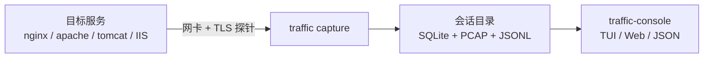

# 使用手册

[← 返回项目首页](../README.md) · [下载版本](https://github.com/Sunmedalia/traffic/releases)

面向网站应急响应的流量采集与分析工具。在 Linux / Windows 目标机上采集 HTTP/HTTPS 请求、响应和网络证据，在本地分析时生成检测依据，用中文 TUI、浏览器或 JSON 命令回看，并导出可校验的证据包。

- **不装 CA、不改业务代码**：Linux 用 eCapture/eBPF 在 OpenSSL 读写处取明文，Windows 用随包 WinDivert 加动态探针。
- **采集与分析分离**：采集器只写会话目录，分析器可在另一台机器打开。
- **完整性显式**：状态文件记录网卡、队列、TLS 丢弃和未知缺口，不把“0 丢弃”说成“采全”。



本轮采集完整性、低影响与 HTTP/2 代码改动及未完成项目见 [优化实施与验收](../OPTIMIZATION.md)。HTTP/2 已加入有界解析和合成回归，实机后端覆盖尚未验收；以下表格保留既有实机结论。

## 先跑起来（Linux）

```bash
# 1. 构建：需要 Go 1.26.7+、CGO、C 编译器、libpcap
sudo apt-get update && sudo apt-get install -y build-essential libpcap-dev git
git clone https://github.com/Sunmedalia/traffic.git && cd traffic
./scripts/build-linux.sh

# 2. 自检：接口、权限、BTF、eCapture、可发现的 TLS 库
#    此时尚未构建 eCapture，ecapture_installed=false 属正常
./bin/traffic doctor

# 3. 先验证链路：只采 HTTP，不需要 eCapture
sudo ./bin/traffic capture --ports 80,443 --no-tls

# 4. 另开终端分析；无参数会列出会话
./bin/traffic-console
```

HTTP 链路确认后，再构建 eCapture 采集 HTTPS 明文：

```bash
sudo apt-get install -y clang llvm bpftool libelf-dev libssl-dev \
  flex bison make file pkg-config
./scripts/build-ecapture.sh /tmp/traffic-ecapture-build
sudo ./bin/traffic capture --ports 80,443 --ecapture "$PWD/bin/ecapture"
```

采集器启动时在 stderr 打印会话绝对路径，停止时写入摘要。先确认这三件事再继续：

1. `status.json` 的 `tls` 为 `attached`（eBPF）或 `active-preload`（预加载），不是 `unavailable`。
2. 从客户端发一条已知请求，`traffic-console requests` 能看到对应记录。
3. 用唯一编号逐条核对请求、响应及正文；`tls_coverage` 仍是 `unverified` 表示启动窗口和探针盲区无法自动量化，不是错误。

> 只做 HTTP 时始终加 `--no-tls`。HTTPS 明文的依赖、探针版本和边界见 [Linux HTTPS 依赖](#linux-https-依赖与-ecapture)。

## 我该用哪个后端

| 你的场景 | 推荐方式 | 要重启服务吗 | 说明 |
| --- | --- | --- | --- |
| 只看 HTTP | `--no-tls` | 否 | 只需 libpcap |
| Linux nginx / apache | 默认 eBPF（eCapture） | 否 | 自动发现 worker，推荐首选 |
| HAProxy / 其他通用 OpenSSL 程序 | eBPF + `--service openssl --pid N` | 否 | 需要显式指定 PID |
| 内核太旧、无 BTF，或选择启动时符号拦截 | `LD_PRELOAD` / `ld.so.preload` | 是 | 启动时加载库；系统级预加载支持白名单 |
| Tomcat / JVM HTTPS | `--java-attach` | 否 | 动态附加 Java Agent |
| Windows IIS / nginx / apache | 随包 WinDivert + 自动配置探针 | 否 | IIS 用 Frida，nginx/apache 用 OpenSSL 探针 |
| 已有 PCAP | `traffic import` | 不涉及 | 保存为原始会话，本地 console 还原 |
| 在分析机上看别人采的会话 | `traffic-console` | 不涉及 | 支持 Linux / macOS / Windows |

## 常见场景（复制即用）

### Linux nginx / apache HTTPS

```bash
# 自动发现 nginx worker、apache2/httpd 及其 libssl
sudo ./bin/traffic capture --interfaces eth0 --ports 80,443 \
  --ecapture "$PWD/bin/ecapture" --output ./sessions/incident-001
```

`--interfaces` 省略时使用 `any`（含回环）。`--libssl` 省略时从目标进程的映射自动发现；指定错误路径会让探针挂到错误的库上。多站点共用 worker 和端口时，采集会包含这些站点。

### 指定进程或通用 OpenSSL 服务

```bash
# 通用 OpenSSL 程序必须给 PID，例如 HAProxy
sudo ./bin/traffic capture --service openssl --pid 1234 --ports 9443

# 只采一个进程，其余服务不附加
sudo ./bin/traffic capture --service nginx --pid 1234 --ports 443
```

### 旧内核与启动加载：LD_PRELOAD

```bash
# 1. 构建采集库（在目标系统构建，匹配 glibc 与 libpcap）
bash scripts/build-openssl-preload.sh

# 2. 启动采集器，等待 tls=listening-preload
sudo ./bin/traffic capture --interfaces any --ports 443 \
  --openssl-preload-socket /run/traffic/plaintext.sock \
  --output ./sessions/old-kernel

# 3a. 单服务：用环境变量加载库
sudo env LD_PRELOAD="$PWD/bin/libtraffic-openssl.so" \
  TRAFFIC_OPENSSL_SOCKET=/run/traffic/plaintext.sock /path/to/service

# 3b. 系统级：安装库、写配置、启动采集器后重启服务
sudo install -m 755 bin/libtraffic-openssl.so /opt/traffic/bin/
sudo mkdir -p /etc/traffic
sudo tee /etc/traffic/openssl-preload.conf >/dev/null <<'EOF'
socket=/run/traffic/plaintext.sock
targets=nginx
EOF
sudo ./bin/traffic capture --interfaces any --ports 443 \
  --openssl-preload-socket /run/traffic/plaintext.sock \
  --openssl-preload-allow-uid 33 --output ./sessions/incident-preload
printf '%s\n' /opt/traffic/bin/libtraffic-openssl.so | sudo tee -a /etc/ld.so.preload
sudo systemctl restart nginx
```

非 root worker 需要 `--openssl-preload-allow-uid`：socket 会变成 `0660` 并归属该 UID 的主组。未匹配 `targets` 的进程不启动采集队列；预加载库仍会被动态链接器载入。完整说明、回滚和边界见 [系统级 ld.so.preload](#系统级-ldsopreload-与不同-uid-的服务)。

### Tomcat / JVM HTTPS

```bash
./scripts/build-java-agent.sh

sudo ./bin/traffic capture --service tomcat --pid 1234 \
  --ports 8080,8443 --java-attach \
  --java-agent "$PWD/bin/traffic-java-agent.jar"
```

目标 JVM 需要允许动态附加。附加助手默认使用目标 Java；JDK 不匹配时用 `--java-helper` 指定带 `jdk.attach` 的 JDK。

### 只看 HTTP 或导入 PCAP

```bash
# 60 秒普通抓包，不启动 TLS 探针
sudo ./bin/traffic capture --no-tls --duration 60s --output ./sessions/http-001

# 将已有 PCAP 保存为会话，再在本地还原
./bin/traffic import capture.pcap --ports 80,8080 --output ./sessions/offline-001
```

### 采集多个服务、多个端口

```bash
sudo ./bin/traffic capture --service auto --ports 80,443,8081,8444,8083,8446 \
  --java-attach --java-pid 1234 --java-agent "$PWD/bin/traffic-java-agent.jar"
```

### 限时采集，再在本地加规则和外送告警

```bash
sudo ./bin/traffic capture --ports 80,443 --ecapture "$PWD/bin/ecapture" --duration 10m \
  --trusted-proxies 10.0.0.0/8,192.0.2.10 \
  --output ./sessions/incident-002

# 停采后，把整个会话复制到本地，再执行：
./bin/traffic-console analyze --session ./sessions/incident-002 \
  --rules ./rules.yaml --alert-webhook https://siem.example/traffic
```

`TRAFFIC_WEBHOOK_TOKEN` 可带 Bearer 令牌。规则格式见[检测规则](#检测规则)。

### Windows

```powershell
powershell -ExecutionPolicy Bypass -File scripts/windows/build.ps1
.\bin\windows\traffic.exe doctor
.\bin\windows\traffic.exe capture --no-tls --ports 80,443 --duration 60s --name windows-http
.\bin\windows\traffic-console.exe
```

IIS、Windows nginx/apache 和通用 OpenSSL 的探针参数见 [Windows 采集](#windows-采集)。

## 分析会话

### 终端界面

使用独立的分析程序，在交互式终端打开正在采集或已经结束的会话。

```bash
# 无参数启动，在界面选择会话
./bin/traffic-console

# 从其他采集根目录选择会话
./bin/traffic-console --data-dir /var/lib/traffic/sessions

# 直接打开指定会话
./bin/traffic-console --session ./sessions/incident-001

# 每两秒刷新，并预设筛选条件
./bin/traffic-console --session ./sessions/incident-001 \
  --refresh 2s --client 192.0.2.10 --severity high
```

无参数启动会递归扫描当前工作目录及程序所在目录对应的 `sessions/`。选择页按主机分组，组内正在采集的会话在前，其余按开始时间从新到旧排列，每行显示状态、开始时间、请求数、告警数和会话名，底部显示选中会话的完整路径。在会话目录内启动也会识别当前会话，兼容旧版平铺目录与新版分层目录。程序识别 v3 原始会话的 `manifest.json`，兼容旧版 `index.sqlite`。新会话必须先执行本地分析才能查询请求；本地请求和告警计数来自同一份分析结果，尚未分析时显示未知。旧索引损坏时标记不可用。

选择页使用 `↑` / `↓`、`j` / `k` 选择，`Enter` 打开，`/` 按会话名、主机或路径即时查找，`r` 重新扫描，`o` 输入其他采集根目录、会话目录或 `index.sqlite` 文件路径。进入分析页后按 `s` 返回会话选择页，光标停在刚才的会话上。仅含 PCAP 或 HTTP 文本的导出目录需要先导入或找到对应的完整会话。

分析页由五部分组成：顶部是会话身份栏（主机 / 日期 / 会话名、采集状态、累计请求与告警、刷新状态）、标签栏和当前筛选条件，底部是提示栏和当前可用按键。四个页面如下。

- **概览**：首行是累计请求、告警命中、告警请求数、网络包和采集时长，下方四个区块是级别分布、命中规则、告警来源和最近高危，回答「多严重、什么攻击、谁在打、最新一条是什么」。`Tab` 在区块间切换，在级别、规则或来源上按 `Enter` 以该条件跳到逐条告警，在最近高危上按 `Enter` 直接打开详情。概览始终统计整个会话，不受筛选影响。
- **请求**：每页 100 条，列宽随终端宽度调整，窄屏只保留时间、方法、状态、级别和 URL。状态码按 2xx / 4xx / 5xx 着色，高危请求的 URL 标红。终端宽度至少 120 列时，详情在右半屏打开；有告警的请求默认显示检测依据。告警的匹配片段在请求、响应和解码正文中反色高亮，检测依据中注明片段在原文出现的次数；匹配只发生在 URL 解码等视图上时会说明原文中未直接出现。详情内按 `/` 查找当前标签的文字，`n` / `N` 在命中处之间跳转。
- **告警**：`v` 在三种视图间切换。按规则视图每条规则一行，显示级别、命中请求数、来源数、最近时间和最近一次匹配片段，级别高的在前；按来源视图每个客户端 IP 一行，显示命中数、涉及规则、首次和最近时间；逐条视图与请求页相同。在聚合行上按 `Enter`，把该规则或来源加入当前筛选并进入逐条视图，`Esc` 退回聚合视图并恢复原来的筛选和光标位置。聚合视图同样受筛选约束。
- **健康**：完整性提示、网络包与各类丢弃、TLS、资源限制、告警推送、服务探针和采集错误。出现丢弃、探针未附加、推送失败或采集错误时标签显示黄色 `!`，采集失败或心跳过期时显示红色 `✕`，提示栏同时给出原因。

光标停在列表第一页第一行时，新记录从顶部进入，状态为「跟随最新」。移动光标、翻页或打开详情后列表定格，行不再移动，页脚提示新增条数，按 `g` 回到最新并恢复跟随。已完成或已停止的会话不显示刷新状态。

筛选对请求页和告警页同时生效，概览和健康页不受影响。条件可组合客户端、规则、级别、时间范围、服务和 Host/URL 关键词，级别按「不低于」理解，规则和级别组合要求同一条告警同时满足。「时间从」和「时间到」可填 `30m`、`2h`、`1d`、`today`、`14:30`、`11-16 14:30`、`2026-11-11 10:00` 或 RFC3339，面板中实时显示换算后的时间；「时间到」留空表示到现在，包含该时刻。`--severity` 命令行参数和 Web 界面采用相同的「不低于」含义。

按 `y` 通过 OSC 52 把选中请求的 ID 复制到剪贴板，提示栏同时显示 ID，终端不支持 OSC 52 时可手动选取。设置 `NO_COLOR` 环境变量后界面不输出颜色，级别、状态和告警用文字、符号、粗体和反色区分。

在列表或详情中按 `e` 导出选中请求的证据压缩包，默认保存到当前目录的 `evidence-<ID>.zip`。导出需要采集锁，采集进行中会提示先停止采集，目标文件已存在时不覆盖。

| 按键 | 操作 |
| --- | --- |
| `1` / `2` / `3` / `4` | 切换概览、请求、告警、健康，各页记住自己的光标 |
| `s` | 返回会话选择页 |
| `↑` / `↓` 或 `j` / `k` | 选择请求或滚动详情 |
| `g` / `G` | 回到最新并恢复跟随 / 本页末尾 |
| `n` / `p`、`←` / `→`、`PgDn` / `PgUp` | 列表翻页 |
| `Enter` | 打开请求详情，或在概览区块、告警聚合行上下钻 |
| `Tab` / `Shift+Tab` | 切换请求、响应、解码正文、检测依据 |
| `J` / `K` | 在详情中查看下一条 / 上一条请求，可跨页 |
| `c` / `m` / `H` | 只看选中请求的客户端 / 命中规则 / Host，再按一次取消 |
| `x` | 清空全部筛选 |
| `/` | 打开筛选面板，`Tab` 或 `↑` / `↓` 换行，`←` / `→` 切换选项，`Enter` 应用，`Ctrl+R` 清空 |
| `e` / `y` | 导出选中请求的证据 / 复制请求 ID |
| `/`（详情内）、`n` / `N` | 在当前标签中查找，跳到下一处 / 上一处 |
| 空格 / `r` | 暂停或恢复自动刷新 / 手动刷新 |
| `Tab` / `Shift+Tab`（概览） | 切换级别分布、命中规则、告警来源、最近高危区块 |
| `v` | 告警页切换按规则、按来源、逐条视图 |
| `Esc` | 关闭弹层、清除详情查找、关闭详情，或从下钻结果返回原页面 |
| `?` | 打开快捷键帮助 |
| `q` / `Ctrl+C` | 退出 TUI |

默认每秒自动刷新，历史页保持当前浏览位置，打开的详情会更新后续到达的响应。暂停刷新后仍可手动刷新和查询。宽度达到 120 列时详情与列表分栏，窄终端使用独立详情页。建议至少 80 列、24 行，时间按界面标注的本地时区显示。

详情显示保存的请求响应文本、可用的 gzip 请求正文解码结果，以及规则版本、命中片段和解码来源。不完整及截断记录在列表和详情中标注。采集心跳超过五秒未更新时提示心跳过期，状态文件缺失时仍可浏览 SQLite 中的请求。分析程序以只读方式打开现有 SQLite 索引，证据导出写入指定的新 ZIP 文件。运行用户需要会话目录和文件的读取权限，普通查询和界面浏览无需管理员权限。

### 浏览器界面

```bash
./bin/traffic-console web --session ./sessions/incident-001
./bin/traffic-console web --data-dir /var/lib/traffic/sessions --listen 127.0.0.1:9000
```

启动后 stderr 会打印带访问令牌的地址，直接打开即可。默认只监听回环，远程分析建议用 `ssh -L 8080:127.0.0.1:8080 user@host` 转发；`--allow-remote` 会让令牌和正文以明文过网，只用于隔离网络。

页面分为会话选择、概览、请求和告警四部分，地址栏记录当前会话、标签、筛选条件和打开的记录，刷新、后退和复制地址都会回到同一视图。

- **会话选择**按日期分组，显示状态、主机、请求数和告警数，可按名称、主机或目录查找。
- **概览**显示累计计数、数据缺口提示、请求与告警时间线、命中规则、来源地址、告警级别和响应状态分布、最近告警以及采集状态。点击规则、来源或分布项会跳到对应的筛选结果，在时间线上拖选会把列表限定到这段时间。
- **请求 / 告警列表**每页 100 条，支持 Host/URL 关键词、级别、响应状态、请求方法、来源地址、规则、服务和起止时间组合筛选，输入后即时生效。列表上方的时间线随筛选条件变化，同样可以拖选缩小范围。翻到历史页时保持当前位置，并提示新到达的请求数。
- **详情**显示解码后的 URL、查询参数和表单参数，在请求内容里标出规则命中的片段，JSON 正文可格式化显示。gzip 请求和响应正文在“解码正文”中查看。来源、Host、服务和规则可以直接点击作为筛选条件。“复制 cURL”生成可复现请求的命令，“导出证据”下载与 `traffic-console export` 相同的 ZIP，采集进行中时导出会被拒绝。

采集中的会话按 `--refresh` 间隔自动刷新，默认每秒一次，最小 500 毫秒。已结束的会话降为每 5 秒检查一次，时间线和统计的刷新间隔不低于 5 秒。索引较大时，响应状态分布超过 1.5 秒会被跳过并在页面上说明。右上角可以切换本地时间与 UTC、深色与浅色配色，详情栏宽度可拖动调整。

| 按键 | 操作 |
| --- | --- |
| `1` / `2` / `3` | 切换概览、请求、告警 |
| `j` / `k` 或 `↓` / `↑` | 下一条、上一条请求 |
| `g` / `G` | 本页第一条、最后一条 |
| `n` / `p` | 下一页、上一页 |
| `[` / `]` | 切换详情标签 |
| `/` | 聚焦搜索框 |
| 空格 / `r` | 暂停或恢复自动刷新 / 立即刷新 |
| `Esc` | 关闭详情或离开输入框 |
| `?` | 打开快捷键帮助 |

### 命令行查询

```bash
./bin/traffic-console status   --session SESSION
./bin/traffic-console requests --session SESSION --limit 100
./bin/traffic-console requests --session SESSION --client 192.0.2.10 --rule SQLI-001
./bin/traffic-console events   --session SESSION --severity high
./bin/traffic-console show EVENT_ID --session SESSION
./bin/traffic-console export EVENT_ID --session SESSION --out ./evidence.zip
```

筛选参数：`--since`（RFC3339）、`--client`、`--rule`、`--severity`、`--service`、`--limit`。TUI/Web 另有 Host/URL 关键词。`show` 含可读正文和 base64 字节；原始网络字节在 PCAP 里。采集中不能导出，先停止采集。分析程序以只读方式打开索引，运行用户需要会话目录和文件的读取权限，普通查询不需要 root。

## 停止、回滚与清理

| 场景 | 操作 |
| --- | --- |
| 正常结束采集 | `Ctrl+C`，等待摘要写出 |
| 定时结束 | 启动时加 `--duration 10m` |
| 预加载回滚 | 只移除本工具对应的预加载条目，再重启目标服务；保留其他库条目 |
| 确认库已卸载 | `grep libtraffic /proc/PID/maps` 应无输出 |
| 删除测试产物 | 直接删除会话目录；证据 ZIP 与会话目录分开保存 |
| Web 令牌失效 | 重启 `traffic-console web`，或用 `TRAFFIC_WEB_TOKEN` 固定 |

采集程序不会自动注册系统服务或修改站点配置。动态探针须按后端显式启用；预加载须在目标进程启动时加载。实验环境搭建脚本会创建相应测试服务，勿与采集命令混淆。

### 从旧版本升级

- `traffic tui` 改为独立程序 `traffic-console`。
- `traffic status/requests/events/show/export` 改为 `traffic-console ...`。
- 原来的 `traffic analyze` 改名为 `traffic import`，用于离线 PCAP。
- 会话格式保持兼容：分析器可读旧版平铺目录和新版分层目录，证据导出同样支持。

## 参数速查

### 采集器 `traffic capture`

| 参数 | 默认 | 用途 |
| --- | --- | --- |
| `--interfaces` | Linux `any` | 网卡列表，逗号分隔 |
| `--ports` | `80,443` | 抓包与 TLS 事件的本地端口 |
| `--service` | `auto` | `auto` / `nginx` / `apache` / `tomcat` / `openssl` / `iis` |
| `--pid` | 0 | 限定目标进程 |
| `--ecapture` | `/opt/traffic/bin/ecapture` | eCapture 路径 |
| `--libssl` | 自动发现 | 指定 TLS 库，排错时很有用 |
| `--no-tls` | 关 | 只保存网络包，不启动 TLS 探针 |
| `--openssl-preload-socket` | 空 | 启用预加载后端 |
| `--openssl-preload-allow-uid` | 空 | 允许非 root 服务账号写入 |
| `--trusted-proxies` | 空 | 保存可信代理 IP/CIDR，供本地还原来源使用 |
| `--output` | 自动 | 精确会话目录 |
| `--data-dir` | `./sessions` | 自动命名会话的根目录 |
| `--name` | `capture` | 会话名 |
| `--duration` | 0 | 到时自动停止 |
| `--disk-limit-mib` | 2048 | 会话磁盘预算 |
| `--no-detect` | 兼容参数 | 采集始终不执行检测 |
| `--require-tls` | 关 | 所选目标未通过 HTTPS 预检时拒绝开始 |
| `--collector-memory-mib` / `--collector-cpu-percent` | 256 / 50 | 限制采集器及子进程，不含目标内探针 |
| `--drain-timeout` | 5s | 部分后端的数据排空预算，最大 15s |
| `--netns-pid` | 0 | Linux 显式选择抓包网络命名空间 |

`traffic capture --help`、`traffic doctor`、`traffic-console rules check FILE` 可随时查看。`doctor` 默认显示中文自检报告，网卡掩码转为 CIDR；自动化读取请使用 `traffic doctor --json`，原始 JSON 字段保持兼容。分析器用 `traffic-console --help` / `--cn-help` 查看总览，`traffic-console web --cn-help`、`analyze --cn-help`、`rules --cn-help` 查看各命令的中文参数和示例；`--help` 为英文帮助。

## 会话目录与完整性

```text
sessions/web-01/2026-11-11/15-04-05-nginx/
├── manifest.json     # 主机、名称、过滤条件、布局版本
├── status.json       # 心跳、计数、丢弃、错误、资源限制
├── gaps.jsonl        # 带原因、后端、连接和单位的已知缺口
├── analysis-current.json # 本地分析成功后创建的结果指针
├── analysis-*.sqlite  # 本地还原、索引、告警及规则快照
├── capture.lock
├── packets/          # 顺序分段 PCAP（HTTPS 仍是密文）
├── tls/stream.jsonl   # 原始探针事件 JSONL（按需创建）
└── logs/             # 探针诊断
```

采集器只保存原始数据，不执行还原、配对和索引。PCAP 每段约 64 MiB，顺序保留，不循环覆盖；达到磁盘预算或剩余空间低于 512 MiB 时停止。磁盘检查存在间隔，可能略超预算。探针仍有单事件及队列上限，零丢弃不证明采全。停止采集后复制整个目录；旧会话还需保留 `index.sqlite-wal`/`-shm`。判断完整性看 `status.json`：

- `gap_counts` / `gaps.jsonl`：按后端、原因和计量单位保存已知缺口；`drain_state` 和 `probe_exits` 分别报告排空及退出确认。
- `tls`：`attached` / `active-preload` / `partial` / `unavailable` / `disabled`。
- `tls_dropped`、`queue_dropped`、`dropped`：已观测丢弃，是下限。
- 原始采集阶段 `transactions`、`alerts`、`tls_requests` 不表示业务请求数量；还原计数和完整性来自本地分析报告。
- `tls_coverage=unverified`、`tls_missing_estimate=null`：启动窗口和探针盲区未知，需要外部请求计数核对。

## 故障排查

| 症状 | 常见原因 | 处理 |
| --- | --- | --- |
| `doctor --json` 报 `ecapture_installed: false` | 未构建或路径不对 | 跑 `scripts/build-ecapture.sh`，或用 `--ecapture` 指定 |
| 抓不到任何请求 | 网卡或端口不对 | `ip -br addr` 选接口；确认 `--ports` 含实际监听端口 |
| 只有密文、`tls=unavailable` | 未发现服务、库路径错、后端不支持 | 看 `doctor` 的 targets；指定 `--service` / `--pid` / `--libssl` |
| nginx 采集到了但部分请求缺失 | 附加前已进入的调用、HTTP/2、突发缺口 | 用预加载路径或降低速率；完整性按 `unverified` 处理 |
| 预加载无事件 | 服务未重启、targets 不匹配、socket 权限 | 重启 master；检查 `/etc/traffic/openssl-preload.conf`、`ls -l /run/...`、`--openssl-preload-allow-uid` |
| 预加载报 `bind: no such file or directory` | 父目录不存在（旧版本） | 升级到当前版本，或先 `mkdir -p /run/traffic` |
| `permission denied` 打开 BPF | 非 root 或缺少权限 | 用 `sudo`；容器内需要相应 capability |
| TUI 找不到会话 | 工作目录或路径不对 | `--session` 指向会话目录；`o` 输入其他根目录 |
| 导出失败 | 采集仍在运行，或目标 ZIP 已存在 | 先停止采集，换一个新的输出路径 |
| 时间对不上 | 采集机时钟/时区 | 会话存 UTC，TUI 按本地时区显示；先校时再采 |
| Web 打不开 | 监听地址或令牌 | 用启动时打印的完整地址；远程用 SSH 转发 |

## 检测规则

### Web 规则文件管理

启动 `traffic-console web` 后，点击顶部「规则与分析」。左侧选择文件，右侧编辑 YAML；支持新建、导入 UTF-8 文件、校验、保存、下载及删除。内置规则只读。保存前校验规则 ID、字段、级别和正则，校验失败不会覆盖文件；文件版本冲突时需重新打开，避免覆盖其他窗口的修改。

默认目录为程序旁的 `rules/`，从源码构建到 `bin/` 时使用项目根目录的 `rules/`。Web 启动时自动创建目录，与当前工作目录无关；用 `--rules-dir` 可覆盖默认位置。单文件最多 1 MiB，最多 256 个文件，不接受目录穿越或符号链接文件。

```bash
./traffic-console web --data-dir ./sessions --rules-dir ./rules
```

面板下方选择会话，再选「仅内置规则」或「内置 + 文件名」，点击「开始分析」。任务在后台运行，页面可继续浏览；可用「停止分析」取消任务。每次使用启动时的规则快照，修改或删除文件不改变正在运行的任务或已有结果。任务完成后，页面自动刷新告警；同一 Web 服务一次只运行一个分析任务，服务退出时取消未完成任务。Web 分析不触发 Webhook。

### 命令行分析与规则格式

当前源码已将 TCP/HTTP 还原、请求响应配对、索引及检测移到本地分析器（尚未发布；v0.1.2 包仍采用旧流程）。`capture` 和 `import` 只保存原始流量；先停止采集，再执行 `traffic-console analyze --session DIR`。新原始会话在分析前没有可查询的请求表，Web 可在「规则与分析」中启动任务。

每次分析从原始 PCAP 和 `tls/stream.jsonl` 重建事务，再按采集时间执行内置及本次追加的规则。结果存入不可变的 `analysis-*.sqlite`，包括本地还原正文、索引、告警、规则内容/指纹和完成时间；`analysis-current.json` 原子切换当前结果。原始流量和状态文件保持只读，失败或取消保留上次完整结果。旧版 `index.sqlite` 会话继续使用原索引，支持本地规则重算。

TUI、Web、JSON 查询及导出读取同一代分析结果；Web 和 TUI 每次刷新读取最新结果。源文件大小或修改时间变化会使结果失效，需重新分析；这项快速检查不代替证据哈希校验。导出包含 `analysis.json`，原始会话另含 `reconstructed-event.json`，旧会话使用 `captured-event.json` 区分原索引记录。

`traffic-console analyze --request-limit BYTES --response-limit BYTES` 控制本地正文还原和检测上限，默认每侧 1 MiB，最大 16 MiB；Web 使用默认值。上限造成的本地截断可通过调大后重新分析恢复，采集缺口则无法补回。`--retention` 已从采集器删除，旧版循环 PCAP 曾被覆盖的内容无法恢复。

内置规则覆盖疑似 SQL 注入、命令注入、路径穿越、敏感文件探测、扫描、XSS、SSRF、XXE、SSTI、JNDI、反序列化、Webshell 上传，以及响应中的 passwd / 命令输出特征。原始内容和最多两轮 URL 解码视图参与匹配，gzip 正文有界解压。告警是疑似信号，结论要结合响应和现场证据。

```yaml
- id: CUSTOM-001
  version: 1
  severity: medium
  field: url
  pattern: '(?i)/suspicious-endpoint'
```

```bash
./bin/traffic-console rules check rules.yaml
./bin/traffic-console analyze --session ./sessions/incident-002 --rules rules.yaml
```

`field` 支持 `url`、`request`、`response`、`request.headers`、`response.headers`、`request.body`、`response.body`，单个头部用 `request.header.User-Agent` 这类写法。`severity` 为 `low` / `medium` / `high`。扫描检测默认 60 秒内至少 20 个不同路径且一半以上为 404，在 `traffic-console analyze` 中用 `--scan-window`、`--scan-paths` 调整。

### 可信代理与来源地址

```bash
--trusted-proxies 10.0.0.0/8,192.0.2.10,2001:db8::/32
```

直连对端可信时，从右向左解析 `X-Forwarded-For` 的第一个非可信地址；没有该头时用单值 `X-Real-IP`。索引和告警用解析后的 `client`，`peer_client` 保留直连端点，`client_source` 记录依据。代理头不带端口，解析后端口记为 `0`。

### 告警外送

`traffic-console analyze --alert-webhook URL` 在分析成功后异步 POST 告警 JSON，`TRAFFIC_WEBHOOK_TOKEN` 发送 Bearer 令牌，接收端可用 `Idempotency-Key` 去重。单次超时 3 秒，429/5xx 最多重试三次；队列 128 条、4 MiB，退出最多等 5 秒。投递计数和失败信息在本次 analyze 的 JSON 输出中返回，不写入采集状态；失败或溢出的告警仍保存在本地分析库。重跑并指定 Webhook 会再次发送本次全部告警。

## 资源与证据限制

| 项目 | 默认 |
| --- | --- |
| 请求 / 响应正文 | 256 KiB / 64 KiB，超出标记截断 |
| HTTP 头部 | 32 KiB |
| PCAP | 每接口 64 MiB 分段、16 段循环 |
| 会话磁盘预算 | 2 GiB，达到后停止采集 |
| 低磁盘保护 | 可用空间不足 512 MiB 时停止 |
| 索引保留期 | 24 小时 |
| 进程资源 | Linux cgroup v1/v2 / Windows Job Object，256 MiB、单核 50% |

证据 ZIP 含请求、响应、关联 PCAP 和 SHA-256 清单；PCAP 按客户端端点及请求前后各 60 秒筛选，可能包含同连接上的其他请求。HTTPS 明文来自进程探针，PCAP 仍是原始密文。明文事件、Cookie 和认证信息可能出现在会话里，分享前先检查。

## Linux HTTPS 依赖与 eCapture

eCapture 以独立子进程运行，仓库固定上游提交 `143e771cf2b4919aedc27fd7b4b24ff87b8725b9` 并应用补丁。当前构建脚本按主机架构生成 ARM64 或 x86_64 的 CO-RE 探针，构建目标含 OpenSSL 1.1.1 四组 ABI 及 3.0、3.5；1.1.1 的完整运行验收仍待完成，包含自定义 BIO 的 socket 关联和 `SSL_read_ex`、`SSL_write_ex` 支持。

```bash
sudo apt-get install -y clang llvm bpftool libelf-dev libssl-dev \
  flex bison make file pkg-config
./scripts/build-ecapture.sh /tmp/traffic-ecapture-build
```

构建目录必须不存在。脚本生成 `bin/ecapture`、许可证、校验文件及 `.traffic.json` 能力清单，部署时保留这些配套文件。补丁修复连接缓存崩溃与 FD 复用的元数据竞争，减少解码复制；TLS 事件使用 100 毫秒时间排序窗口，空闲时也会刷新末批事件。补丁扩展了内部 ABI，探针字节码与用户态解码器必须配套构建。其他 OpenSSL 版本需要单独验证。

## 各后端细节与边界

### 预加载（LD_PRELOAD / ld.so.preload）

库在 `SSL_read`、`SSL_write` 及 `_ex` API 返回后复制实际消费或产生的明文，经有界异步队列发送到 Unix socket；采集器校验内核凭据和 `/proc` 进程启动标识，保存原始明文事件，停采后由 console 还原。该路径可在内核 3.10 上运行。

#### 系统级 `ld.so.preload` 与不同 UID 的服务

`/etc/ld.so.preload` 不能设置环境变量，因此库读取 `/etc/traffic/openssl-preload.conf`，也可用 `TRAFFIC_OPENSSL_CONFIG` 指定：

```ini
socket=/run/traffic/plaintext.sock
targets=nginx,httpd,apache2
# debug_file=/tmp/traffic-preload-debug.log
```

`targets` 是逗号分隔的进程名，支持末尾 `*` 前缀匹配，`*` 表示全部；不匹配的进程保持惰性。采集器用 `--openssl-preload-allow-uid 33` 放行 www-data，socket 为 `0660` 并归属该 UID 的主组，新建的父目录会设置为可穿越；已有父目录权限保持不变，需要操作者为服务账号配置访问权限。

`ld.so.preload` 只影响之后 `exec` 的进程：`nginx -s reload` 不会重新加载 master 的库，必须重启 master。worker 由 master fork，master 启动时载入后即覆盖 worker。回滚时只移除本工具对应的库条目并重启服务，确认 `/proc/PID/maps` 不再包含该库。`debug_file` 每次进程首次初始化写一行，默认关闭。

队列最多 128 条事件，单条约 19 KiB，采用有界原子预留与独立后台消费。连接元数据分为 64 个分片，每片最多 64 项；满片或争用超过等待预算会报告缺口。发送线程有界重试，恢复时先发送缺口标记再发送后续正文。可上报缺口计入 `tls_dropped`；进程崩溃、`_exit`、采集器停机和最后未送出的事件仍是未知缺口。Linux cgroup v1/v2 在控制器可用且有权限时限制采集器，实际结果见 `resource_limits`，不改变目标服务的 cgroup。已测动态 OpenSSL 1.0.2k / TLS 1.2，以及 Debian 13 / OpenSSL 3.5 / nginx 1.26 的系统级预加载、TLS 1.2/1.3 和非 root worker；静态链接、绕过符号拦截、自定义无 socket BIO、Go TLS、HTTP/2 和长期性能未验证。

### Apache

自动发现 `apache2` / `httpd`，采集 OpenSSL HTTPS 明文。worker/prefork 在采集开始前已经阻塞在 `SSL_read` 的调用，首次返回可能漏采，后续调用和新连接正常。`scripts/verify-services.py` 可对已运行服务做串行验收。

### Tomcat / Java Agent

显式 `--java-attach` 才附加，支持 Tomcat 9/JDK 17、Tomcat 10.1/JDK 21 的 NIO Connector。Agent 用一条发送线程和 128 个分片槽位，单片 64 KiB，队列正文最多 8 MiB；溢出会标记缺口。停止后通道关闭、Agent 停用并恢复字节码，同一 JVM 可再次附加，但 Agent 不支持在同一 JVM 内热升级。禁止附加的 JVM 会报失败，网卡采集继续。

### 通用 OpenSSL

`--service openssl --pid N` 适用于使用 OpenSSL 的其他程序。已用 HAProxy 和外部 `SSL_read_ex` / `SSL_write_ex` 调用验证；OpenSSL 3.0 `s_server -www` 的内置 BIO 路径实测未取得明文，自定义 BIO 目前适配 Apache。

## Windows 采集

从源码构建需要 Go 1.26.7+ 和 x64 MinGW GCC；正式发行包已包含 WinDivert、Python、Frida 和探针，无需安装 Npcap。

```powershell
powershell -ExecutionPolicy Bypass -File scripts/windows/build.ps1
.\bin\windows\traffic.exe doctor
.\bin\windows\traffic.exe capture --no-tls --ports 8080,8443 --duration 60s --name windows-http
```

完整发行包默认使用 WinDivert 覆盖本机接口和回环；也可用 `doctor` 返回的 `windivert:接口索引` 或系统接口名。旧的 Npcap 回退仅适用于自行构建。抓包快照上限 256 KiB，避免回环大帧截断。证据目录使用继承 ACL；Job Object 限制 256 MiB 内存和单核 50% CPU。

### IIS

```powershell
# 完整发行包已包含 Python / Frida；在管理员 PowerShell 运行
.\traffic.exe doctor --service iis
.\traffic.exe capture --service iis --ports 8080,8443 --duration 60s
```

IIS 探针动态附加 `w3wp.exe`，在 HTTP Server API 收发边界复制明文，无需安装模块或回收应用池。`probe-runtime` 目录必须允许目标应用池身份读取。动态附加只能看到附加之后进入的调用。IIS 10 默认应用池在附加前已经向 HTTP.sys 预投递约 10 个 `HttpReceiveHttpRequest`，这 10 个请求的完成通知对不上探针登记表，明文必然丢失。请求数少于这个数时，`plaintext_observed` 可能为 false，这不表示该 IIS 版本不能解密。判定前先向本机端口连续发送多于预投递数的请求（实测先打 15 个以上），再看 `status.json`：

- `probe_receive_matches > 0` 表示请求接收 hook 命中；`plaintext_observed=true` 表示请求侧原始事件已记录。这不代表还原、配对成功；停采后由 console 分析。
- `probe_send_matches > 0` 但 `probe_receive_matches=0`：只命中了响应，请求侧仍在盲区。
- `attach_window_suspect=true`：同时满足「响应命中、请求 0 条、完成通知有未命中」。单独的未命中不算，工作进程里还有探针没登记的其它 I/O。`gaps.jsonl` 在结束时记一条 `unmatched_completion_unknown`，不在收包路径上逐条写。

`--require-plaintext` 在未附加 IIS 或未记录任何请求侧原始事件时以非 0 退出；写入/排空失败也会使采集失败。它不要求采集端进行 HTTP 还原。`--require-tls` 只检查附加前的预检，不保证采到明文。停止时可能因未完成 I/O 导致运行时未完全卸载。实测范围是 Windows 10 17763 与 19044、HTTP/1.1、TLS 1.2。

### Windows nginx / apache / 通用 OpenSSL

```powershell
.\traffic.exe capture --service nginx --ports 80,443
.\traffic.exe capture --service apache --ports 80,443
.\traffic.exe capture --service openssl --pid 1234 --ports 9443 --libssl libssl-3-x64.dll
```

官方 Windows nginx 静态链接 OpenSSL，内置 profile 按二进制 SHA-256 和函数入口匹配；其他静态版本需要 `--openssl-profile`。辅助脚本目录需同时保留 `probe-openssl.py`、`probe-iis.py`、`openssl-plaintext.js` 和 `openssl-profiles.json`。动态附加只覆盖附加后进入的调用，附加前已阻塞的读取和半截消息可能漏采。Windows 的完整验收脚本为 `scripts/windows/verify-iis.py` 和 `scripts/windows/verify-middleware.py`。

## 构建（分平台）

```bash
# Linux：竞态测试、go vet、两个程序与校验文件
./scripts/build-linux.sh

# 也可以分别构建
go build -o bin/traffic ./cmd/traffic
go build -o bin/traffic-console ./cmd/traffic-console
```

分析程序可在 Linux、macOS 或 Windows 构建；Linux eBPF 和 Windows IIS 后端必须运行在对应目标系统。构建出的采集器、分析器和 eCapture 必须同架构。

## 验证范围

| 平台或服务 | 能力 | 实机边界 |
| --- | --- | --- |
| Linux ARM64 / x86_64 HTTP | 网卡抓包、HTTP/1.1 重组、循环 PCAP | 支持分段、乱序、重传、长连接、中文、分块 |
| Linux nginx / OpenSSL | 运行中采集 HTTPS 明文、客户端端点、进程身份 | ARM64/x86_64 的 TLS 1.2/1.3 通过 |
| Linux Apache | 自动发现并采集 OpenSSL 明文 | ARM64 event/worker/prefork 已测，阻塞读取有首次漏采边界 |
| Linux Tomcat / JSSE | 动态附加 Java Agent | Tomcat 9/JDK 17、10.1/JDK 21 NIO 已测 |
| Linux 通用 OpenSSL | 指定 PID 采集 | HAProxy、外部 `_ex` 调用已测 |
| Linux 预加载 | `LD_PRELOAD` / `ld.so.preload` | CentOS 7 / OpenSSL 1.0.2k；Debian 13 / OpenSSL 3.5 / nginx 非 root worker 已测 |
| Windows IIS 10 | Npcap HTTP + 动态 HTTPS | 17763、HTTP/1.1、TLS 1.2 已测 |
| Windows nginx / apache | Npcap HTTP + OpenSSL 探针 | nginx 1.28、Apache 2.4.71 的 TLS 1.2/1.3 正文比对通过 |
| Windows 通用 OpenSSL | 指定 PID | 外部 `_ex` 调用通过，内置 BIO 路径未取得明文 |

完整实机数据和证据位置见 [验证记录](../VALIDATION.md)。

### 已知限制

- HTTP/2 已实现有界帧、HPACK 和多路复用解析，完整后端实机矩阵未验收；中途附加缺少 HPACK 历史时保留证据并停止不可靠解码。HTTP/3、WebSocket 内容解析、通用 JSSE/Go TLS、Tomcat NIO2 尚未支持；HTTP/1.1 流缺失消息开头时恢复受限。
- 持续高负载仍有 eCapture 接收预算耗尽及后端不可用的失败样本；正式低影响门槛、八小时长压和各后端端到端排空尚未完成。
- Windows 其他 Web 服务、IIS TLS 1.3、内核缓存直接命中、应用池替换、长期性能和 Frida 完整卸载未验收；IIS 启动窗口可能漏采。
- Linux x86_64 的 Apache、Tomcat、通用 OpenSSL 和长期性能仍待单独验收。
- 代理来源地址依赖可信代理配置和正确的转发头，默认使用连接对端。
- Web 界面已覆盖令牌、筛选、详情和导出测试，真实网卡到浏览器的完整链路仍待实机验收。

## 测试

```bash
go test -race ./...
go vet ./...
```

CI 在 ARM64 / x86_64 Linux 执行格式检查、竞态测试、静态检查和构建，Windows x64 执行原生测试与构建，Java 17/21 执行 Maven 测试与打包。PCAP/PCAPNG 离线导入使用纯 Go 读取器，Windows 无需 Npcap 即可运行离线集成测试；发布流程另验证随包 WinDivert 的回环 HTTP 实际采集。

实机脚本需要兼容的测试站接口（`/api/health`、`/api/echo`、`/search`、未知路径 404），串行发送请求，输出目录必须为新目录：

```bash
python3 scripts/verify.py /tmp/traffic-functional --host 127.0.0.1
python3 scripts/benchmark.py --output /tmp/traffic-performance --host 127.0.0.1
```

脚本支持 `--binary` 和 `--config` 指定采集程序与 Nginx 配置。功能脚本另通过 `--analysis-binary` 指定证据导出所用的 `traffic-console`，默认路径为 `/opt/traffic/bin/traffic-console`。可用 `--ecapture` 指定探针路径、`--pid` 将 TLS 探针限定到实验进程。功能脚本检查 126 条请求及响应、已有 HTTPS 连接、TLS 版本、中文正文、五类规则、网站配置和 PID、证据校验。性能脚本默认 20/100 请求每秒、每组五分钟、重复三轮。

## 第三方组件

依赖及版本见 `go.mod`、`go.sum`。eCapture 以独立子进程运行，固定源码、补丁和构建方式随仓库提供。版权与许可证说明见 [THIRD_PARTY_NOTICES.md](../THIRD_PARTY_NOTICES.md)。
